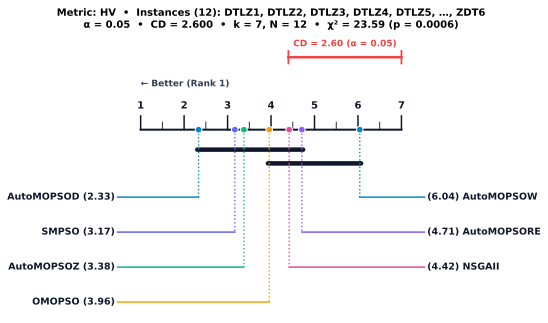

---
hide:
  - navigation
---

<div class="saes-hero" markdown>

<div class="saes-hero-body" markdown>
<div class="saes-badges">
  <span class="saes-badge">v{{ saes_version }}</span>
  <span class="saes-badge">Python {{ saes_python_requires }}</span>
  <span class="saes-badge">{{ saes_plotters_count }} Plotters · {{ saes_renderers_count }} Table Formats</span>
  <span class="saes-badge">{{ saes_license }}</span>
</div>

# SAES — Stochastic Algorithm Evaluation Suite

An open-source scientific Python library for rigorous **frequentist**, **exact Bayesian**, **equivalence (TOST)**, **power/sensitivity (MDES)**, and **Dolan–Moré meta-benchmarking** statistical evaluation of stochastic optimization algorithms, metaheuristics, and machine learning models.

<div class="saes-hero-actions" markdown>
[Get Started](getting-started/quickstart.md){ .md-button .md-button--primary }
[Statistical Methodology](methodology.md){ .md-button }
[Python API](api-reference.md){ .md-button }
</div>
</div>
</div>

## Why SAES?

Evaluating stochastic algorithms across multiple problem instances introduces well-known statistical traps: silent assumptions of paired runs when stochastic seeds are independent, unblocked pooled ANOVA causing pseudoreplication across instances, invalid Kolmogorov–Smirnov $p$-values on estimated parameters, and missing effect-size confidence intervals.

**SAES** eliminates these pitfalls by unifying validated statistical pipelines, transparent methodological safeguards, publication-grade visualizations, LaTeX/PDF/DOCX reporting, and FAIR reproducibility artifacts under one strictly typed Python API.

<div class="grid cards" markdown>

-   :material-shield-check:{ .lg .middle } **Assumption-Driven Decision Engine**

    ---

    Runs Shapiro–Wilk, Lilliefors KS, Anderson–Darling, D'Agostino–Pearson $K^2$, and Brown–Forsythe Levene checks automatically — with explicit `paired=False` default for independent runs.

    [:octicons-arrow-right-24: Decision Engine](user-guide/decision-engine.md)

-   :material-podium-gold:{ .lg .middle } **Complete Blocked Omnibus & 13 Post-Hoc Rules**

    ---

    Tie-corrected Friedman, Iman–Davenport $F$, Friedman Aligned-Ranks, Quade, and Greenhouse–Geisser RM-ANOVA, paired with Tukey HSD, Games–Howell, Dunnett, Dunn, Conover–Iman, Shaffer, and Bergmann–Hommel.

    [:octicons-arrow-right-24: Blocked & Post-Hoc](user-guide/blocked-and-posthoc.md)

-   :material-chart-bell-curve-cumulative:{ .lg .middle } **Exact Bayesian Models, MDES & TOST**

    ---

    Benavoli Bayesian Sign & Signed-Rank Simplex (relative or absolute ROPE), Nadeau–Bengio Bayesian Correlated $t$-test, Calvo Bayesian Plackett–Luce ranking, exact MDES sensitivity, and Schuirmann TOST equivalence.

    [:octicons-arrow-right-24: Bayesian & TOST](user-guide/bayesian-and-equivalence.md)

-   :material-chart-box-outline:{ .lg .middle } **10 Publication Figures & LaTeX/FAIR Packs**

    ---

    Generate publication-ready SVG/PDF/PNG plots (CD diagrams, Bayesian simplex, Plackett–Luce, Effect-Size Forest plots) and standalone LaTeX/PDF/DOCX tables + SHA-256 FAIR reproducibility scripts.

    [:octicons-arrow-right-24: Visualizations & Tables](user-guide/visualization-and-tables.md)

</div>

## Installation

=== "pip"

    ```bash
    # Core statistical engine (NumPy, Pandas, Pydantic V2, SciPy, Statsmodels)
    pip install saes

    # With publication plotting (Matplotlib, Seaborn, Plotly)
    pip install "saes[viz]"

    # Full suite (Core + Visualization + FastAPI REST server)
    pip install "saes[all]"
    ```

=== "uv"

    ```bash
    uv add saes
    uv add "saes[viz]"
    uv add "saes[all]"
    ```

## 30-Second Quickstart

```python
import saes

# 1. Load and strictly validate a tidy long-format benchmark CSV
dataset = saes.load("datasets/swarmintelligence.csv")
assert saes.validate(dataset).is_valid

# 2. Explore distributions & dataset-aware test recommendations
exploration = saes.explore(dataset, alpha=0.05)
print("Top recommendation:", exploration.recommendations[0].test_name)

# 3. Blocked multi-instance frequentist & Bayesian ranking
cd = saes.statistics.friedman_nemenyi(dataset, metric="HV", alpha=0.05)
pl = saes.statistics.bayesian_plackett_luce(dataset, metric="HV", num_samples=400)
print(cd.summary())
print(pl.summary())

# 4. Standardized Effect-Size Forest with exact 95% CIs
forest = saes.statistics.effect_size_forest(dataset, metric="HV", instance="DTLZ2")
print(forest.summary())

# 5. Standalone publication LaTeX table + FAIR reproducibility bundle
table = saes.generate_table(dataset, metric="HV", posthoc_correction="holm", paired=False)
latex_bytes = saes.export_table(table, export_format="latex")
repro = saes.reproducibility(dataset, metric="HV", filename="swarmintelligence.csv")
```

<figure class="saes-figure" markdown>

<figcaption>
<strong>Figure 1:</strong> Publication-ready Demšar (2006) Friedman + Nemenyi Critical Distance diagram generated directly via <code>saes.export_plot(dataset, plot_type="critical-distance", metric="HV", export_format="svg")</code> on the bundled 7-optimizer, 12-instance <code>swarmintelligence.csv</code> benchmark.
</figcaption>
</figure>

## Comparison with Related Statistical Libraries

| Capability | SAES (`saes`) | SciPy | Pingouin | Autorank | scmamp (R) |
| :--- | :---: | :---: | :---: | :---: | :---: |
| Tidy multi-instance benchmark validation | :material-check-circle:{ style="color:#10b981" } | — | — | Partial | — |
| Explicit `paired=False` safeguard & assumption diagnostics | :material-check-circle:{ style="color:#10b981" } | Manual | Partial | — | — |
| Friedman, Aligned-Ranks, Quade & RM-ANOVA (GG $\varepsilon$) | :material-check-circle:{ style="color:#10b981" } | Friedman only | RM-ANOVA | Friedman | All 3 non-param |
| 13 Multiplicity adjustments incl. Shaffer & Bergmann–Hommel | :material-check-circle:{ style="color:#10b981" } | — | Partial | Nemenyi | Yes |
| Exact effect-size CIs ($d, g, \eta^2, A_{12}, \delta$) + Forest plot | :material-check-circle:{ style="color:#10b981" } | — | Partial | — | — |
| Bayesian Sign, Signed-Rank, Correlated $t$ & Plackett–Luce | :material-check-circle:{ style="color:#10b981" } | — | — | Signed-Rank | Plackett–Luce |
| Power planning, MDES sensitivity & TOST equivalence | :material-check-circle:{ style="color:#10b981" } | — | Power only | — | — |
| Dolan–Moré performance profiles & Copeland meta-ranking | :material-check-circle:{ style="color:#10b981" } | — | — | — | — |
| LaTeX / PDF / DOCX tables & SHA-256 FAIR packs | :material-check-circle:{ style="color:#10b981" } | — | — | LaTeX only | LaTeX only |
| Optional typed FastAPI REST API + Interactive Web/Desktop UI | :material-check-circle:{ style="color:#10b981" } | — | — | — | — |

## How to Cite SAES

If you use **SAES (`saes`)** in a scientific paper or empirical benchmark, please cite the software using the bundled [`CITATION.cff`](https://github.com/saes-suite/saes/blob/main/CITATION.cff) metadata or the following BibTeX entry:

```bibtex
@software{carreira_saes_2026,
  author  = {Carreira, Emilio R. and Nebro, Antonio J.},
  title   = {{SAES}: Stochastic Algorithm Evaluation Suite},
  version = {{{ saes_version }}},
  url     = {https://saes-suite.github.io/saes/},
  license = {GPL-3.0-or-later}
}
```
