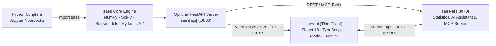

# REST API & Ecosystem Architecture

While `saes` is a standalone, zero-UI scientific Python library at its core, installing the optional `[api]` extra exposes a fully typed **FastAPI** REST server (`saes-api`, default port `:8060`) that powers the **SAES Web/Desktop Studio** (`saes-ui`) and **SAES Conversational AI / MCP Server** (`saes-ai`).

## Ecosystem Architecture (API-First & Thin Client)



Every statistical computation, assumption diagnostic, dataset capability check, and plot/table export lives strictly inside **`saes`** — guaranteeing 100% numerical parity between Python scripts, REST calls, AI tool calls, and the interactive UI.

## Launching the Optional REST Server

```bash
pip install "saes[all]"
saes-api
# Interactive OpenAPI / Swagger UI available at http://127.0.0.1:8060/docs
```

## Complete REST Endpoint Reference

*(Auto-discovered live from `saes.server.app` for `v{{ saes_version }}`.)*

{{ saes_auto_rest_endpoints_table }}

## Example `curl` Request

```bash
# Run Games-Howell post-hoc test on stored dataset
curl "http://127.0.0.1:8060/api/v1/datasets/swarmintelligence.csv/posthoc?metric=HV&instance=DTLZ2&method=games_howell&alpha=0.05"

# Compute Bayesian Correlated t-test for 10-fold CV (rho = 1/9)
curl "http://127.0.0.1:8060/api/v1/datasets/ml_data.csv/bayesian/correlated-ttest?metric=accuracy&algo_a=RandomForest&algo_b=SVM&rope=0.01&rho=0.111111"
```
