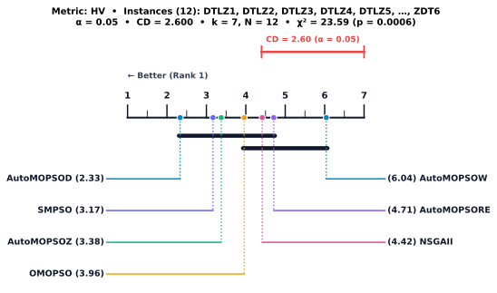
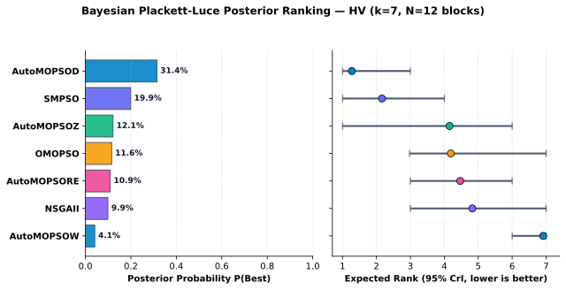
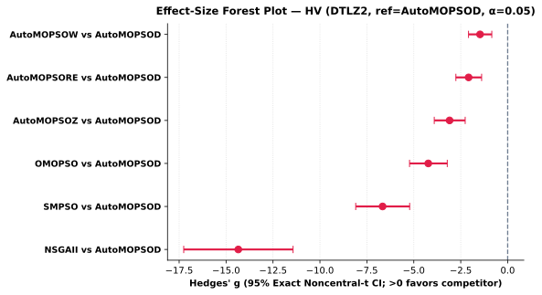

# Tutorial 1: Multi-Objective Metaheuristics Benchmark

This tutorial walks through a complete frequentist, Bayesian, and meta-benchmarking evaluation of 7 multi-objective particle swarm and evolutionary optimizers (`AutoMOPSOD`, `AutoMOPSORE`, `AutoMOPSOW`, `AutoMOPSOZ`, `NSGAII`, `OMOPSO`, `SMPSO`) across 12 DTLZ/ZDT benchmark instances using the bundled `datasets/swarmintelligence.csv`.

## 1. Load, Validate, and Explore the Dataset

```python
import saes

ds = saes.load("datasets/swarmintelligence.csv")
val = saes.validate(ds)
assert val.is_valid, f"Validation failed: {val.issues}"

print("Algorithms:", ds.algorithms)
print("Metrics:", ds.metrics)
print("Instances:", len(ds.instances))

# Distribution & assumption diagnostics (Shapiro-Wilk, Lilliefors, Anderson-Darling, D'Agostino, Levene)
exploration = saes.explore(ds, metrics=["HV", "IGD+"], alpha=0.05)
print("Normality pass rate:", f"{exploration.context_diagnostics.normality_rate:.1%}")
print("Top recommendation:", exploration.recommendations[0].test_name)
```

## 2. Blocked Multi-Instance Omnibus Tests

Because 7 stochastic optimizers are evaluated across 12 matched benchmark instances, global comparisons must use **blocked** omnibus tests rather than unblocked one-way ANOVA or Kruskal–Wallis:

```python
# Tie-corrected Friedman + Iman-Davenport F + Nemenyi Critical Distance (Demšar 2006)
cd = saes.statistics.friedman_nemenyi(ds, metric="HV", alpha=0.05)
print(cd.summary())
print(cd.to_dataframe())

# Higher-power blocked alternatives (García et al. 2010)
far = saes.statistics.friedman_aligned_ranks(ds, metric="HV", alpha=0.05)
quade = saes.statistics.quade(ds, metric="HV", alpha=0.05)
rm = saes.statistics.rm_anova(ds, metric="HV", alpha=0.05, greenhouse_geisser=True)
print(far.summary())
print(quade.summary())
print(rm.summary())
```

<figure class="saes-figure" markdown>

<figcaption>
<strong>Critical Distance Diagram (HV, α = 0.05):</strong> Thick horizontal bars connect optimizers whose average ranks differ by less than the Nemenyi Critical Distance.
</figcaption>
</figure>

## 3. Exact Bayesian Multi-Algorithm & Pairwise Comparison

```python
# Bayesian Plackett-Luce ranking across all 7 optimizers (Calvo et al. 2018)
pl = saes.statistics.bayesian_plackett_luce(ds, metric="HV", num_samples=400)
print(pl.summary())
print(pl.to_dataframe())

# Bayesian Signed-Rank simplex with exact absolute ROPE = 0.01 HV units (Benavoli et al. 2017)
bayes = saes.statistics.bayesian_signed_rank(
    ds,
    metric="HV",
    rope=0.01,
    algo_a="NSGAII",
    algo_b="SMPSO",
)
print(bayes.summary())
```

<figure class="saes-figure" markdown>

<figcaption>
<strong>Bayesian Plackett–Luce Posterior Ranking (HV):</strong> Coherent joint posterior probabilities <em>P(Best)</em> summing to 100% alongside 95% credible intervals on expected rank.
</figcaption>
</figure>

## 4. Cell-Level Post-Hoc Testing & Effect-Size Forest Plot

For a specific instance (`DTLZ2`), stochastic solver runs are **independent** (`paired=False`):

```python
cell = ds.get_cell("DTLZ2", "HV")
groups = {
    alg: grp["value"].to_numpy(dtype=float)
    for alg, grp in cell.groupby("algorithm")
}

# Non-parametric omnibus + Dunn / Conover-Iman post-hoc
kw = saes.statistics.kruskal(groups, alpha=0.05)
print(kw.summary())  # includes Epsilon-squared + 95% bootstrap CI

dunn = saes.statistics.dunn(groups, alpha=0.05, p_adjust="holm")
print(dunn.to_dataframe().head())

# Heteroscedastic stochastic dominance via Brunner-Munzel + Vargha-Delaney A12 CI
bm = saes.statistics.brunner_munzel({"NSGAII": groups["NSGAII"], "SMPSO": groups["SMPSO"]})
print(bm.summary())

# Pairwise standardized effect-size forest with exact 95% CIs vs reference optimizer
forest = saes.statistics.effect_size_forest(ds, metric="HV", instance="DTLZ2", paired=False)
print(forest.summary())
```

<figure class="saes-figure" markdown>

<figcaption>
<strong>Standardized Effect-Size Forest Plot (DTLZ2, HV):</strong> Exact noncentral-<em>t</em> 95% confidence intervals for Hedges' <em>g</em> against the best-performing reference optimizer.
</figcaption>
</figure>

## 5. Dolan–Moré Performance Profiles, Tables, Plots & Reproducibility

```python
# Dolan-Moré performance profiles with multiplicity-adjusted Win/Tie/Loss
prof = saes.profiles(ds, metric="HV", alpha=0.05, paired=False, posthoc_correction="holm")
for item in prof.meta_rankings[:3]:
    print(f"{item.algorithm}: rho(1)={item.efficiency:.2%}, Copeland={item.copeland_score:+.3f}")

# Publication-ready standalone LaTeX table (automatically uses blocked global tests)
tbl = saes.generate_table(ds, metric="HV", posthoc_correction="holm", paired=False)
latex_bytes = saes.export_table(tbl, export_format="latex")

# Publication-ready vector SVG export (requires saes[viz])
svg_bytes, _, _ = saes.export_plot(ds, plot_type="critical-distance", metric="HV", export_format="svg")

# FAIR reproducibility pack (Python script, Jupyter notebook, SHA-256 manifest)
repro = saes.reproducibility(ds, metric="HV", alpha=0.05, filename="swarmintelligence.csv")
print("Statsmodels version:", repro.manifest.statsmodels_version)
```
