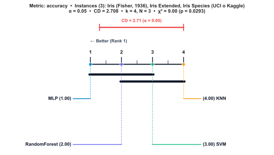

# Tutorial 2: Machine Learning Cross-Validation, Correlated Bayesian $t$-Test & Equivalence (TOST)

This tutorial demonstrates evaluating four classifiers (`KNN`, `MLP`, `RandomForest`, `SVM`) on accuracy and loss across matched cross-validation folds using `datasets/ml_data.csv`, highlighting **explicit pairing**, the **Bayesian Correlated $t$-test** (Nadeau & Bengio 2003; Benavoli et al. 2017), **sensitivity (MDES)** analysis, and **TOST equivalence testing** (Schuirmann 1987; Lakens 2017).

## 1. Load & Analyze Matched Cross-Validation Folds (`paired=True`)

Unlike independent stochastic optimization runs (`paired=False`), classifiers evaluated on the **exact same cross-validation splits** are statistically paired by `run_id`. Declare `paired=True` explicitly:

```python
import saes

ds = saes.load("datasets/ml_data.csv")
assert saes.validate(ds).is_valid

# Automated analysis explicitly declaring matched CV folds
report = saes.analyze(ds, alpha=0.05, generate_plots=False, paired=True)
print(report.to_dataframe()[["instance", "metric", "test_name", "p_value", "effect_size_value"]])
```

<figure class="saes-figure" markdown>

<figcaption>
<strong>Classifier Ranking (Accuracy):</strong> Friedman + Nemenyi Critical Distance diagram generated directly from <code>datasets/ml_data.csv</code>.
</figcaption>
</figure>

## 2. Bayesian Correlated $t$-Test for Repeated $k$-Fold Cross-Validation

Standard paired $t$-tests underestimate variance across overlapping $k$-fold CV training sets. Use `saes.statistics.bayesian_correlated_ttest` with $\rho = n_{\text{test}} / n_{\text{train}}$ (e.g., $\rho = 1/9$ for 10-fold CV) and a practical ROPE of $\pm 0.01$ accuracy points:

```python
cell = ds.get_cell("Iris (Fisher, 1936)", "accuracy")
piv = cell.pivot(index="run_id", columns="algorithm", values="value").dropna()

bct = saes.statistics.bayesian_correlated_ttest(
    piv["RandomForest"].to_numpy(dtype=float),
    piv["SVM"].to_numpy(dtype=float),
    algo_a="RandomForest",
    algo_b="SVM",
    rope=0.01,
    rho=1.0 / 9.0,
    maximize=True,
)
print(bct.summary())
```

## 3. Sensitivity Analysis (MDES) & TOST Equivalence Testing

When a frequentist comparison yields $p \ge 0.05$, never conclude the classifiers are equivalent without checking sensitivity (MDES) and running an equivalence test:

```python
# Sensitivity audit: what minimum Cohen's d can this design detect at 80% power?
pwr = saes.power(ds, metric="accuracy", alpha=0.05, target_power=0.80, paired=True)
print(pwr.summary())

mdes_10folds = saes.statistics.minimum_detectable_effect(
    n=len(piv),
    target_power=0.80,
    alpha=0.05,
    paired=True,
)
print(f"Minimum Detectable Effect Size (n={len(piv)}, paired): d_z = {mdes_10folds:.3f}")

# Formal TOST equivalence test within +/- 0.02 accuracy points (Schuirmann 1987; Lakens 2017)
eq = saes.tost(
    piv["RandomForest"].to_numpy(dtype=float),
    piv["SVM"].to_numpy(dtype=float),
    low_eqbound=0.02,
    alpha=0.05,
    paired=True,
    group_1="RandomForest",
    group_2="SVM",
)
print(eq.summary())
```

## 4. Parametric & Non-Parametric Multi-Group Post-Hoc Comparisons

```python
groups = {col: piv[col].to_numpy(dtype=float) for col in piv.columns}

# Check normality with Shapiro-Wilk, Lilliefors, and Anderson-Darling
for chk in saes.statistics.lilliefors(groups, alpha=0.05):
    print(chk.name, f"D={chk.statistic:.4f}, p={chk.p_value:.4f}, passed={chk.passed}")

# All-pairs post-hoc (Tukey HSD, Games-Howell, or Dunnett vs. a baseline classifier)
dunnett_res = saes.statistics.dunnett(groups, control="SVM", alpha=0.05)
print(dunnett_res.summary())
print(dunnett_res.to_dataframe())

# Standardized effect-size forest with exact 95% CIs (paired CV folds)
forest = saes.statistics.effect_size_forest(
    ds, metric="accuracy", instance="Iris (Fisher, 1936)", paired=True
)
print(forest.summary())
```
