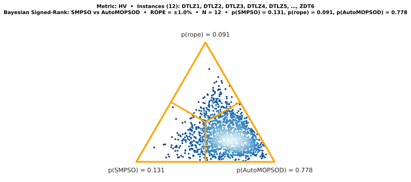
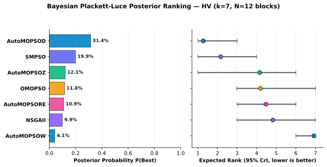

# Bayesian Inference, Sensitivity (MDES) & Equivalence (TOST)

Frequentist $p$-values answer whether a null hypothesis of *zero* difference can be rejected, but they cannot quantify the probability that two algorithms are **practically equivalent** or directly estimate the posterior probability that an algorithm is best. SAES provides a complete Bayesian + Sensitivity + Equivalence toolkit.

## 1. Bayesian Sign & Signed-Rank Simplex with ROPE

Following **Benavoli et al. (2017)** (*JMLR*), SAES evaluates pairwise multi-instance differences against a **Region of Practical Equivalence (ROPE)** $[-\Delta, +\Delta]$, returning posterior probabilities $(P_{\text{left}}, P_{\text{rope}}, P_{\text{right}})$ that sum to $1.0$:

- **`saes.statistics.bayesian_sign(...)`** — Dirichlet posterior on win/tie/loss counts.
- **`saes.statistics.bayesian_signed_rank(...)`** — Dirichlet Process posterior weighted by difference magnitudes.
- Supports both **relative** (`rope_percent=1.0`) and **exact absolute** (`rope=0.01`) ROPE bounds, plus configurable Dirichlet prior concentration (`prior_strength=1.0`).

```python
import saes

ds = saes.load("datasets/swarmintelligence.csv")
bayes = saes.statistics.bayesian_signed_rank(
    ds,
    metric="HV",
    rope=0.01,            # exact absolute ROPE in HV units
    prior_strength=1.0,
    algo_a="NSGAII",
    algo_b="SMPSO",
)
print(bayes.summary())
```

<figure class="saes-figure" markdown>

<figcaption>
<strong>Figure 2:</strong> Ternary Dirichlet Process posterior cloud for <code>bayesian_signed_rank</code> on <code>HV</code> across all 12 benchmark instances, showing decision boundaries for <em>P(left)</em>, <em>P(ROPE)</em>, and <em>P(right)</em>.
</figcaption>
</figure>

## 2. Bayesian Plackett–Luce Multi-Algorithm Ranking

Pairwise Bayesian tests can yield non-transitive conclusions when comparing $k \ge 3$ algorithms. Following **Calvo et al. (2018)**, `saes.statistics.bayesian_plackett_luce` jointly models complete block rankings across all $k$ algorithms to produce coherent posterior winning probabilities $P(\text{best})$ summing strictly to $1.0$ along with $95\%$ credible intervals on expected ranks:

```python
pl = saes.statistics.bayesian_plackett_luce(ds, metric="HV", num_samples=400, seed=42)
print(pl.summary())
print(pl.to_dataframe())
```

<figure class="saes-figure" markdown>

<figcaption>
<strong>Figure 3:</strong> Dual-panel Bayesian Plackett–Luce figure generated by <code>saes.export_plot(ds, plot_type="plackett-luce", metric="HV", export_format="svg")</code> showing posterior <em>P(Best)</em> (left) and expected rank with 95% credible intervals (right).
</figcaption>
</figure>

## 3. Bayesian Correlated $t$-Test (Cross-Validation)

In $k$-fold or repeated $k$-fold cross-validation, training sets overlap, inducing positive correlation $\rho \approx n_{\text{test}} / n_{\text{train}}$ among fold differences (**Nadeau & Bengio 2003**; **Benavoli et al. 2017**). `saes.statistics.bayesian_correlated_ttest` computes the exact analytical Student-$t$ posterior density (`curve_x`, `curve_y`) and exact ROPE probabilities:

```python
bct = saes.statistics.bayesian_correlated_ttest(
    x_a, x_b,
    algo_a="RandomForest",
    algo_b="SVM",
    rope=0.01,
    rho=1.0 / 9.0,  # 10-fold CV correlation correction
)
print(bct.summary())
```

## 4. A Priori Power, Sensitivity (MDES) & TOST Equivalence

!!! important "Why Sensitivity (MDES) Replaces Observed Post-Hoc Power"
    As established by **Hoenig & Heisey (2001)**, observed post-hoc power is a 1-to-1 transformation of the observed $p$-value and adds no new information for non-significant tests. SAES reports exact **Minimum Detectable Effect Sizes (MDES)** alongside a priori sample-size planning.

```python
# Exact MDES for n=30 independent runs at 80% power, alpha=0.05
mdes = saes.compute_minimum_detectable_effect(n=30, target_power=0.80, alpha=0.05, paired=False)
print(f"Detectable Cohen's d >= {mdes:.3f}")

# Formal Schuirmann (1987) / Lakens (2017) TOST equivalence test within +/- 0.02
eq = saes.tost(
    x_a, x_b,
    low_eqbound=0.02,
    alpha=0.05,
    paired=False,
    equal_var=False,
    group_1="NSGAII",
    group_2="SMPSO",
)
print(eq.summary())
```

An algorithm pair is declared **statistically equivalent** at level $\alpha$ if and only if $p_{\text{TOST}} = \max(p_{\text{lower}}, p_{\text{upper}}) < \alpha$, equivalently when the $(1 - 2\alpha)$ confidence interval lies strictly inside $[\Delta_L, \Delta_U]$.
