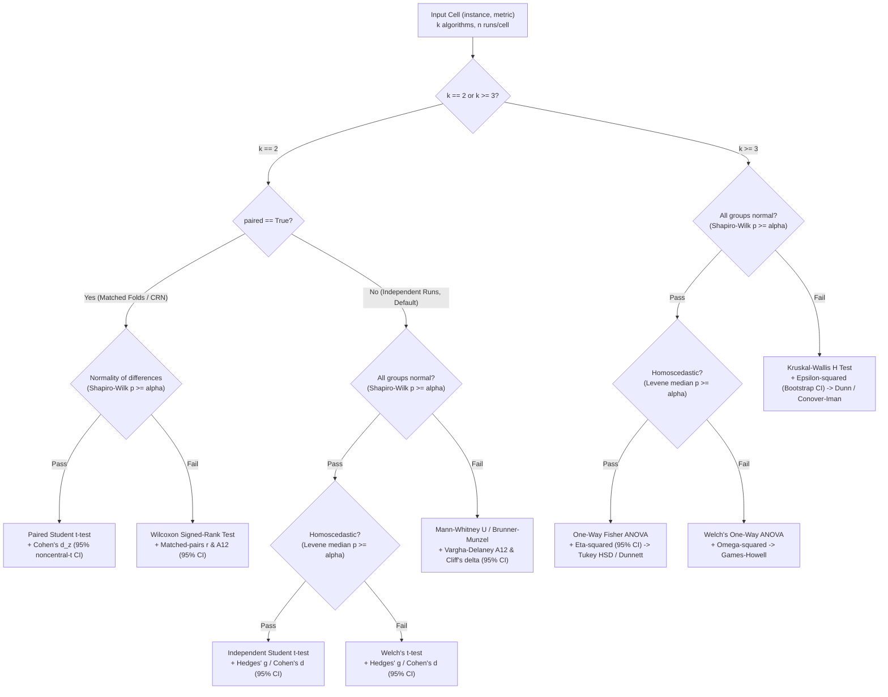

# Statistical Decision Engine & Methodological Safeguards

SAES automates hypothesis test selection while remaining 100% transparent and methodologically conservative. Every assumption check, rationale, and safeguard is stored on the returned Pydantic V2 result object.

## Automated Cell-Level Decision Tree

For each `(instance, metric)` experimental cell, `saes.analyze(dataset, alpha=0.05, paired=False)` executes the following assumption-driven decision flow:

## Normality & Variance Diagnostics

`saes.explore()` and `saes.statistics.*` compute a full suite of distribution checks:

| Check | Function | Exact Method | When It Shines |
| :--- | :--- | :--- | :--- |
| **Shapiro–Wilk** | `saes.statistics.shapiro` | Royston's $W$ | Highest power for small-to-moderate samples ($3 \le n \le 5000$) |
| **Lilliefors KS** | `saes.statistics.lilliefors` | `statsmodels.stats.diagnostic.lilliefors` | Valid KS test when $\mu, \sigma$ are estimated from sample data |
| **Anderson–Darling** | `saes.statistics.anderson` | $A^2$ with Stephens (1986) $p$-value | Sensitive to heavy tails and skewed extreme values |
| **D'Agostino–Pearson $K^2$** | Included in `explore()` | Omnibus skewness & kurtosis test | Recommended for larger run counts ($n \ge 20$) |
| **Levene (Brown–Forsythe)** | `saes.statistics.levene` | Median-centered variance test | Robust to non-Gaussian distributions |

!!! note "Why Lilliefors Instead of Raw `kstest(..., 'norm')`?"
    Standard one-sample Kolmogorov–Smirnov assumes the population mean and variance are known *a priori*. Plugging sample estimates $\bar{x}, s$ into `scipy.stats.kstest` yields severely anti-conservative $p$-values. SAES uses **Lilliefors' corrected distribution** everywhere.

## Built-In Methodological Safeguards

SAES actively prevents four common errors in empirical algorithm benchmarking:

1. **No Implicit Pairing (`paired=False` Default)**
   Stochastic optimization runs (`run_id`) are independent random seeds unless the researcher explicitly declares `paired=True` (e.g., identical cross-validation folds or Common Random Numbers).
2. **No Multi-Instance Pseudoreplication**
   When generating global multi-instance summary tables (`N > 1` instances), SAES suppresses unblocked one-way ANOVA and Kruskal–Wallis across pooled runs and reports **blocked** omnibus tests instead (Friedman, Iman–Davenport, Friedman Aligned-Ranks, Quade, and RM-ANOVA with Greenhouse–Geisser $\varepsilon$).
3. **Single-Run Cell Guard (`can_run_cell_tests`)**
   When a benchmark provides only $n=1$ observation per `(algorithm, instance)` cell (e.g., deterministic algorithms or pre-aggregated instance means), `explore().context_diagnostics.can_run_cell_tests` is `False`, guiding both Python callers and `saes-ui` toward blocked multi-instance tests and Bayesian ranking models.
4. **Multi-Metric Pooling Warning**
   When pooling heterogeneous metrics (`metric="all-metrics"`) in ranking analyses, SAES attaches explicit methodological warnings noting that correlated quality indicators (e.g., `HV` and `IGD+` on the same problem) violate block independence.
