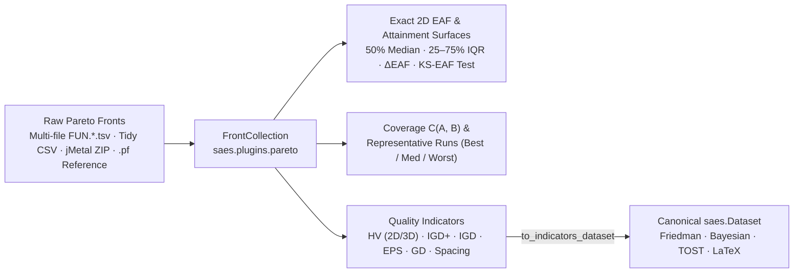

# Pareto Fronts & Empirical Attainment Functions (`saes.plugins.pareto`)

SAES ships a built-in domain plugin — **`saes.plugins.pareto`** — registered via the exact same PEP `importlib.metadata.entry_points` protocol (`saes.plugins`) available to third-party packages. It provides multi-objective Pareto front analytics, exact 2D **Empirical Attainment Functions (EAF)**, **KS-EAF permutation testing**, set coverage $C(A, B)$, and a seamless bridge that converts raw approximation fronts into canonical 6-column **`saes.Dataset`** tables.



---

## 1. Input Dataset Formats

Unlike core SAES scalar benchmarks (6 fixed columns: `algorithm, instance, metric, run_id, value, maximize`), a **Pareto Front Study** stores collections of $m$-dimensional objective vectors ($m \ge 2$) across independent runs, algorithms, and problem instances, optionally paired with a **Reference Pareto Front** per instance.

=== "Tidy Multi-Run CSV"

    Store all runs, algorithms, and instances in a single long-format CSV file.

    - **Required**: `algorithm` plus **2 or more numeric objective columns** (e.g., `f1, f2` or `f1, f2, f3`).
    - **Optional**: `instance` (defaults to `"Problem"`), `run_id` (or `run` / `iteration`, defaults to `0`).
    - **Reference Fronts**: rows with `algorithm` equal to `Reference`, `PF`, or `TrueFront` are automatically promoted to `reference_fronts[instance]`, or you can pass an external `.pf` / `.csv` file via `reference_front=...`.

    ```csv
    algorithm,instance,run_id,f1,f2
    NSGA-II,ZDT1,0,0.05,0.82
    NSGA-II,ZDT1,0,0.25,0.54
    NSGA-II,ZDT1,1,0.08,0.79
    MOEA/D,ZDT1,0,0.02,0.88
    MOEA/D,ZDT1,1,0.04,0.84
    Reference,ZDT1,0,0.00,1.00
    Reference,ZDT1,0,0.25,0.50
    Reference,ZDT1,0,1.00,0.00
    ```

    ```python
    from saes.plugins import pareto

    fronts = pareto.load_csv("fronts.csv", reference_front="ZDT1.pf")
    ```

=== "jMetal / PlatEMO Directory Tree"

    Point SAES directly at a standard multi-objective experiment folder (or upload it as a `.zip` archive in the REST API / UI):

    ```text
    experiment/
    ├── NSGA-II/
    │   └── ZDT1/
    │       ├── FUN.0.tsv
    │       ├── FUN.1.tsv
    │       └── ...
    ├── MOEAD/
    │   └── ZDT1/
    │       ├── FUN.0.tsv
    │       └── ...
    └── reference_fronts/
        └── ZDT1.pf
    ```

    Each `FUN.<run>.tsv` / `.csv` / `.txt` and `.pf` file contains $m \ge 2$ numeric columns delimited by tabs, spaces, or commas (optional header row auto-detected).

    ```python
    from saes.plugins import pareto

    fronts = pareto.load_directory("experiment/", reference_dir="experiment/reference_fronts/")
    # Or from a ZIP archive:
    fronts = pareto.load_zip("experiment.zip")
    ```

=== "In-Memory NumPy Arrays"

    Integrate directly with `jMetalPy`, `pymoo`, or `DEAP` without writing intermediate files:

    ```python
    import numpy as np
    from saes.plugins import pareto

    fronts = pareto.FrontCollection.from_arrays(
        {
            "NSGA-II": [run0_arr, run1_arr, run2_arr],
            "MOEA/D": [moead0_arr, moead1_arr, moead2_arr],
        },
        instance="ZDT1",
        reference_front=true_pf_arr,
        objective_names=("f1", "f2"),
        minimize=(True, True),
    )
    ```

!!! tip "Non-dominated filtering & mixed objective directions"
    Full populations (including dominated points) are accepted safely — `filter_nondominated()` removes dominated and duplicate solutions using an exact $O(N \log N)$ sweep in 2D and exact vectorized checks for $m \ge 3$. Maximization objectives are supported via `minimize=(False, True, ...)`.

---

## 2. Statistical Methodology

### Empirical Attainment Functions (EAF) & Attainment Surfaces

Given $n$ independent non-dominated approximation sets $A_1, \dots, A_n \subset \mathbb{R}^2$ (in minimization space), the **Empirical Attainment Function** (Grunert da Fonseca et al., 2001; López-Ibáñez et al., 2010) generalizes the univariate ECDF to multi-objective sets:

$$
\hat{\alpha}_n(z) = \frac{1}{n} \sum_{r=1}^{n} \mathbb{I}(A_r \preceq z)
$$

where $A_r \preceq z$ denotes that at least one objective vector $a \in A_r$ weakly dominates $z$.

- **0 % (Best attainment surface, $k=1$)**: boundary attained by at least 1 run (the accumulated non-dominated union).
- **25 % – 75 % (Interquartile attainment band)**: multi-objective analog of a boxplot IQR, summarizing stochastic variability across runs without overplotting.
- **50 % (Median attainment surface, $k = \lceil 0.5 n \rceil$)**: the typical front achieved in at least half of all independent runs.
- **100 % (Worst attainment surface, $k=n$)**: region guaranteed to be attained in every single run.

### Spatial EAF Differences ($\Delta\text{EAF}$) & KS-EAF Permutation Test

To compare two stochastic optimizers $A$ ($n_A$ runs) and $B$ ($n_B$ runs) across objective space, SAES computes:

$$
\Delta\text{EAF}(z) = \hat{\alpha}_A(z) - \hat{\alpha}_B(z) \in [-1, 1]
$$

Positive regions ($\Delta\text{EAF}(z) > 0$) indicate objective regions attained more frequently by $A$; negative regions favor $B$. Formal hypothesis testing ($H_0: F_A = F_B$) uses the two-sample Kolmogorov–Smirnov EAF statistic (Fonseca et al., 2005):

$$
T_{\text{obs}} = \sup_{z} \left| \hat{\alpha}_A(z) - \hat{\alpha}_B(z) \right|
$$

evaluated via deterministic Monte Carlo permutations ($B$ shuffles of run labels with fixed `seed`) using the exact Phipson–Smyth estimator $p = \frac{1 + \#\{b : T_b \ge T_{\text{obs}}\}}{B + 1}$.

### Set Coverage $C(A, B)$ & Quality Indicators

- **Set Coverage** (Zitzler & Thiele, 1999): $C(A, B) = \frac{|\{b \in B \mid \exists a \in A : a \preceq b\}|}{|B|} \in [0, 1]$, aggregated across all pairwise run combinations $(A_i, B_j)$.
- **Hypervolume (`HV`)**: exact $O(N \log N)$ sweep for $m=2$, exact $z$-slice decomposition for $m=3$, and deterministic Monte Carlo for $m \ge 4$ (higher is better).
- **Pareto-compliant `IGD+`** (Ishibuchi et al., 2015), classical `IGD`, `GD`, unary **Additive $\varepsilon$-indicator (`EPS`)**, and Schott's **`Spacing`** (lower is better).

---

## 3. End-to-End Python Walkthrough

```python
import saes
from saes.plugins import pareto

# 1. Verify automatic PEP entry-point discovery
assert saes.plugins.is_installed("pareto")

# 2. Load the built-in multi-objective benchmark demo (ZDT1, ZDT2, ZDT3, 3D DTLZ2)
fronts = pareto.create_demo_collection(n_runs=12, seed=42)

# 3. Exact 2D Attainment Surfaces (25%, 50% median, 75%)
att = pareto.attainment(fronts, instance="ZDT1", levels=(0.25, 0.50, 0.75))
print(att.summary())

# 4. Pairwise EAF Difference & KS-EAF permutation test
diff = pareto.eaf_difference(
    fronts,
    instance="ZDT1",
    algo_a="NSGA-II",
    algo_b="MOEA/D",
    n_permutations=500,
    seed=42,
)
print(diff.summary())

# 5. Coverage C(A, B) & Best/Median/Worst Representative Runs
cov = pareto.coverage(fronts, instance="ZDT1")
print(cov.summary())

# 6. Publication-grade Matplotlib (PDF/SVG/PNG) & interactive Plotly figures
#    Modes: 'attainment', 'runs', 'representative', 'eaf-diff', 'small-multiples', '3d', 'pcp'
#    Full ChartWorkbench styling parity (title/legend/font/labels/bold/grid/dark_theme/width_px/height_px)
#    and reference-only rendering (algorithms=[], show_reference=True).
pdf_bytes, _, _ = pareto.export_plot(
    fronts,
    instance="ZDT1",
    mode="attainment",
    algorithms=["NSGA-II", "MOEA/D"],
    show_reference=True,
    legend_placement="top",
    title_mode="full",
    font_size=13,
    font_family="Times New Roman, Times, serif",
    label_mode="all",
    bold_mode="title-axes",
    show_grid=True,
    paper_format="golden",
    palette="academic",
    export_format="pdf",
)

# 7. Seamless bridge to Core SAES statistical suite (Friedman, Bayesian, TOST, LaTeX)
dataset = fronts.to_indicators_dataset(indicators=["HV", "IGD+", "IGD", "EPS", "Spacing"])
assert saes.validate(dataset).is_valid
cd = saes.statistics.friedman_nemenyi(dataset, metric="IGD+")
print(cd.summary())
```

---

## 4. Visualization Modes & REST API

All 7 visualization modes share SAES's `PAPER_FORMAT_PRESETS` (`single-col`, `golden`, `double-col`, `square`, `compact`) and scientific palettes (`academic`, `nature`, `colorblind`, `viridis`, `set2`):

| Mode | Objectives | Description |
| :--- | :---: | :--- |
| `attainment` | 2D | Reference front + 50 % median attainment surface + 25 %–75 % IQR shaded band (+ optional 0 %/100 % envelopes) |
| `runs` | 2D | Overlay individual approximation fronts of 1 or multiple algorithms with adjustable opacity |
| `representative` | 2D | Faint background runs + bold best, median & worst run (ranked by IGD+) + accumulated ND union |
| `eaf-diff` | 2D | Mirrored two-panel $\Delta\text{EAF}(A - B)$ spatial dominance heatmaps + KS-EAF permutation $p$-value |
| `small-multiples` | 2D | Clean per-algorithm facet grid with shared axes and reference front |
| `3d` | $\ge 3$D | Interactive 3D scatter projection (Plotly) / static 3D Axes export (Matplotlib) |
| `pcp` | $\ge 2$D | Normalized Parallel Coordinates Plot relative to ideal/nadir bounds (ideal for Many-Objective) |

When running `saes-api` (`:8060`), `saes.plugins.pareto` is auto-mounted at **`/api/v1/plugins/pareto`**:

- `GET /api/v1/plugins` — Advertises active plugins (triggers the **Benchmarks | Pareto & EAF** mode switcher in `saes-ui`).
- `POST /api/v1/plugins/pareto/collections/create-multi` — Guided multi-file uploader (multiple `FUN.*` run files per algorithm + optional `.pf` reference front).
- `POST /api/v1/plugins/pareto/collections/upload` — Tidy CSV or jMetal/PlatEMO ZIP upload.
- `POST /api/v1/plugins/pareto/collections/demo` — Generates the bundled ZDT1–3 & DTLZ2 demo suite.
- `POST /api/v1/plugins/pareto/collections/{name}/plot` & `/export-plot` — Interactive Plotly JSON and 300-DPI PNG / vector SVG / PDF exports.
- `POST /api/v1/plugins/pareto/collections/{name}/attainment`, `/eaf-diff`, `/coverage` — Typed JSON statistical endpoints.
- `POST /api/v1/plugins/pareto/collections/{name}/to-dataset` — Persists computed quality indicators directly into SAES dataset storage for immediate analysis in Core SAES.
