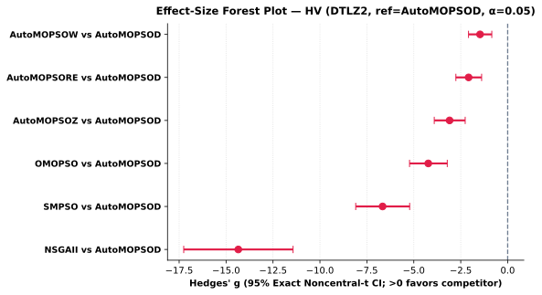
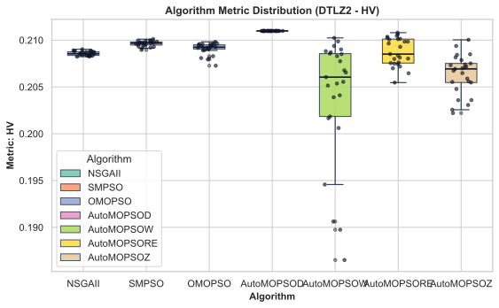

# Visualization, Publication Tables & FAIR Reproducibility

SAES generates publication-grade static figures (**Matplotlib** in SVG, PDF, or 300-DPI PNG), interactive browser figures (**Plotly**), camera-ready benchmark tables (**LaTeX booktabs**, **PDF**, **DOCX**, **CSV**, **Markdown**, **HTML**), and self-contained **FAIR** reproducibility packs.

## 1. Publication Plot Gallery ({{ saes_plotters_count }} Registered Plotters)

All {{ saes_plotters_count }} plotters below are introspected live from `saes.PlotterRegistry` and share a unified API through `saes.plot(...)` and `saes.export_plot(...)` (requires `saes[viz]`):

{{ saes_auto_plotters_table }}

### Effect-Size Forest Plot (Exact 95% Confidence Intervals)

```python
import saes

ds = saes.load("datasets/swarmintelligence.csv")
svg_bytes, _, _ = saes.export_plot(
    ds,
    plot_type="effect-size-forest",
    metric="HV",
    instance="DTLZ2",
    export_format="svg",
)
```

<figure class="saes-figure" markdown>

<figcaption>
<strong>Figure 4:</strong> Standardized Effect-Size Forest Plot on <code>DTLZ2</code> (<code>HV</code>) with exact noncentral-<em>t</em> 95% confidence intervals and Holm-adjusted significance indicators.
</figcaption>
</figure>

### Distribution Boxplot

<figure class="saes-figure" markdown>

<figcaption>
<strong>Figure 5:</strong> Algorithm distribution boxplot on <code>DTLZ2</code> (<code>HV</code>) generated via <code>saes.export_plot(ds, plot_type="boxplot", metric="HV", instance="DTLZ2", export_format="svg")</code>.
</figcaption>
</figure>

## 2. Publication-Ready Benchmark Tables

Generate IEEE / ACM / Springer `booktabs` LaTeX tables, styled vector PDFs, editable DOCX documents, CSVs, Markdown, or standalone HTML:

```python
table = saes.generate_table(
    ds,
    metric="HV",
    table_type="instance_algorithm",  # or "pairwise_matrix", "omnibus_posthoc"
    test_type="auto",
    posthoc_correction="holm",        # supports all 13 adjustments including bergmann_hommel & shaffer
    paired=False,
)

latex_bytes = saes.export_table(table, export_format="latex", latex_notation="siunitx")
pdf_bytes = saes.export_table(table, export_format="pdf", pdf_theme="academic_bw")
docx_bytes = saes.export_table(table, export_format="docx")
```

## 3. Dolan–Moré Performance Profiles & Meta-Benchmarking

```python
profiles = saes.profiles(
    ds,
    metric="HV",
    alpha=0.05,
    paired=False,
    posthoc_correction="holm",
)
for item in profiles.meta_rankings:
    print(f"#{item.rank} {item.algorithm}: Eff={item.efficiency:.1%}, "
          f"Rob={item.robustness:.1%}, Copeland={item.copeland_score:+.3f}")
```

## 4. FAIR Reproducibility Packs

Generate a complete, standalone reproducibility pack containing a pure-Python `reproduce.py` script, an `nbformat v4` Jupyter notebook, and a cryptographic SHA-256 + library version manifest (including Python, `saes`, `numpy`, `scipy`, `pandas`, and `statsmodels`):

```python
repro = saes.reproducibility(ds, metric="HV", alpha=0.05, filename="swarmintelligence.csv")
print("Dataset SHA-256:", repro.manifest.dataset_checksum_sha256)
print("Statsmodels:", repro.manifest.statsmodels_version)
```
